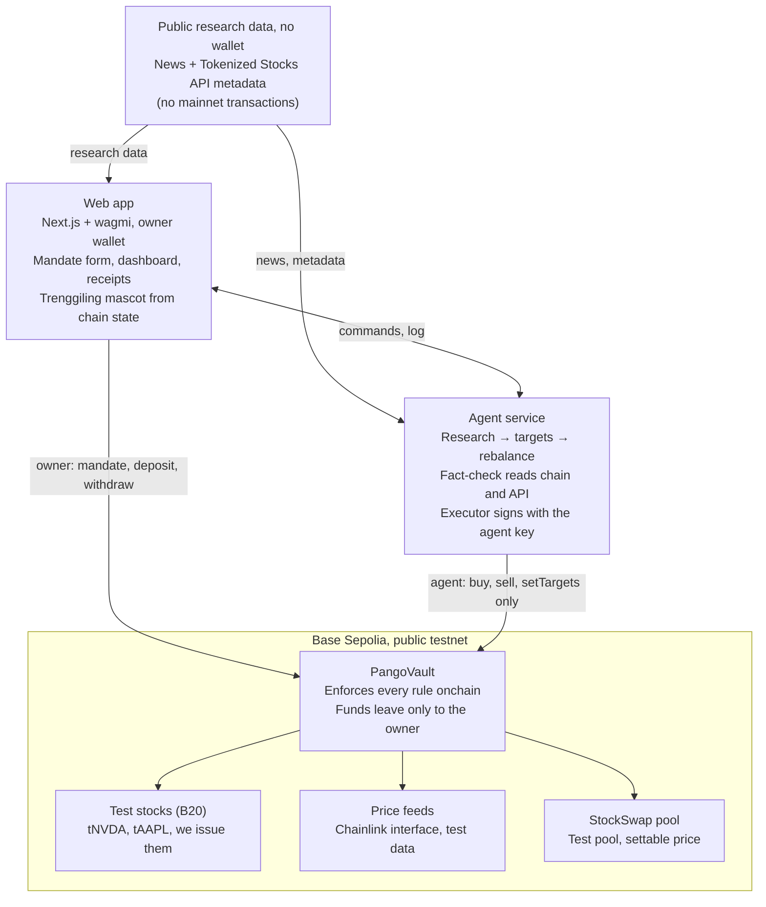

# Pango — Software Requirements Document (SRD)

Nov 15, 2026 · Radit (@Apa) · revised Nov 16, 2026 (see Changelog)

### Changelog

**Nov 16, 2026 — idea validation pass**

- Research weights are hybrid: fixed scoring gives a baseline, the LLM proposes final weights with cited reasons within baseline ± `llmBandBps`; the report lets anyone recompute the baseline and check the band (US-16, US-19, FR-A7, AT-14).
- Cut order fixed now (section 9): shadow panel → web-side Builder Codes → mascot to 3 poses → research step.
- Pitch leads with real S3 data (49 h NVDA weekend freeze, +2.5% reopen) in the Problem section, G3 and section 9.
- Attack console: free-text "try to trick it" is the hero, the 6 presets are shortcuts (US-13, FR-W4).
- Track claim softened to the page's actual wording; judging = official rules only (equal weights, §6 requirements, testnet not penalised); entry needs an X post tagging @buildonbase and the submission form.
- Persona no longer names Jakarta (Indonesia eligibility unconfirmed; ISP blocks Coinbase domains). Test-stock names make clear they are not the real companies' shares (FR-W7).
- S3(b) lead recorded: Base docs say secondary holding is permissionless; verify onchain before the freeze.

**Nov 16, 2026 — API contract decisions D1–D11 (see `docs/API-CONTRACT.md` §9)**

- D1: `maxShares` is in the token's own decimals, not always 18.
- D2: US-01 / AT-01 — the owner configures the deployed demo vault; no vault factory.
- D3: US-15 — weight bounds and tolerance emit `WeightBoundsUpdated` / `ToleranceUpdated`.
- D4: US-09 — no dividend threshold in v1; every pending update blocks.
- D5: FR-W10 — v1 shadow panel is feed-only (real price and age); pool quote waits for S3.
- D11: section 5 now points to API-CONTRACT.md as the single source of truth for the vault interface.

**Nov 16, 2026 — spike S1 and S5 findings**

- Section 5 *Known limit* replaced: announcements are atomic, the vault reads `effectiveAt() > block.timestamp` (never `!= 0`); check step 5 and FR-V4 name the call; open question on the announcement window closed.
- Runbook and tooling pin base-anvil **v1.5.1** (v1.1.0 lacks Cobalt), base-std v1.1.0, OpenZeppelin v5.
- FR-V12 states the valuation formula with token decimals; proven within 1 bps in S5, split-invariant.
- NFR-12 uses measured gas: ~245k per full buy transaction, ~170k post-swap revert, ~12M gas/day budget.
- Section 9 records the spike results.

**Nov 16, 2026 — spike S4 findings**

- FR-A4: errors decoded from the vault ABI plus bubbled OpenZeppelin v5 and B20 errors; proof-mode broadcast only after a chain-id check for Base Sepolia, with an explicit gas limit.
- NFR-12: gas budget counted in gas units; post-swap reverts cost close to a full buy, so proof-mode sends use a 400k gas limit and the daily budget is sized from S5's measured buy gas.

**Nov 16, 2026 — spike S2 findings**

- Invariant test (section 8) now excludes issuer seizure and policy freezes, which no holder contract can prevent.
- NFR-8 "what is not real yet" panel states that real stocks follow issuer transfer rules and can be clawed back.
- Error table adds `PolicyForbids` with the receipt text "The stock's issuer does not allow this transfer right now".
- Runbook step 4: tNVDA and tAAPL need no allowlist setup (default policies allow the vault).

**Nov 16, 2026 — gap review**

- Spike S3 also checks whether a contract may hold real NVDA (policy registry) and reads real corporate-action lead times; dividend threshold `minMultiplierChangeBps` is only a fallback, default stays "block every pending update" (US-09).
- New FR-W10 mainnet shadow panel: read-only, no wallet, no transactions; uses a separate config the signer never loads (FR-A9). All demo trades stay on Base Sepolia.
- Research is deterministic: a fixed, versioned scoring function over a recorded signal snapshot sets the weights; the LLM only explains them; the hashed report lets anyone recompute the weights (US-16, US-19, FR-A7, AT-14).
- Sell side tightened: `dailySellCapUsd` with `ExceedsDailySellCap`, `setTargets` cooldown with `TargetsCooldown`; NFR-3 worst case updated and notes the fair-value rule also blocks sandwich attacks.
- Hosting decided: agent on Railway (one instance, one worker, never asleep), Railway Postgres for the log via `DATABASE_URL` (new NFR-13).

**Nov 16, 2026 — review pass**

- Target check (FR-V13, section 5) is skipped until targets are first set, so AT-02's first buy no longer reverts `OvershootsTarget`.
- Drift is defined as absolute percentage points; `SetDrift` raised from +15% to +30% (AT-15), because +15% moves a 35–40% weight only ~3.3 pp, under the 5 pp trigger.
- Units made split-safe: feed = USDC per UI share (FR-V5, FR-V12, check step 6); `ScheduleSplit` also sets feed and swap price ÷10 at the effective time; owner raises `maxShares` after a split (AT-05).
- Ownership and pause errors use OpenZeppelin v5 (`OwnableUnauthorizedAccount`, `EnforcedPause`); custom `NotOwner`, `Paused` and event `PausedBy` removed (a custom `Paused` error clashes with OZ's `Paused` event). US-03, US-04, AT-08, AT-09, error table updated.
- Counts unified: 6 console presets, each with its named error (US-13); 7 scenario scripts (section 8); G1 reworded.
- Judge live-try: one shared demo vault, judges use chat and the attack console with no wallet (Judge persona, FR-W1); new NFR-12 rate limit and gas budget.
- Video (G3, AT-12) now includes a drift → rebalance.
- Interface: constructor params and `setRouter` (FR-V1), exact `forceApprove`, StockSwap `quote()` for previews (FR-V9), `setTargets` rule for left-out stocks (FR-V11), quantified worst case (NFR-3), Builder Codes (new FR-A10).

## 1. Overview

Pango is a research-to-portfolio agent for tokenized stocks: it turns research into a target portfolio and keeps it rebalanced, while PangoVault, a smart contract on Base, guarantees every trade happens at fair value, never through a stock split, and inside the owner's limits — even when the AI is tricked or its key is stolen. This SRD defines what we build for Base Stocks Maxxing (Agentic Stock Finance track) and how we prove it works on Base Sepolia before the Dec 5, 2026 deadline.

**Promise:** A stock portfolio agent that can't overpay, trade through a stock split, or drift outside the portfolio you approved — even when it's tricked. Because every trade must land at fair value, the same rule also blocks sandwich attacks and bad slippage.

**Mascot:** a trenggiling (pangolin) that curls up when a trade is blocked; its pose always mirrors the contract's state.

### Problem

Tokenized stocks on Base trade 24/7, but the reference price freezes when US markets close and corporate actions change the token-to-share ratio. An AI agent that reads news can be fooled into buying at a weekend premium or chasing a fake split. Existing agent tools keep their limits inside the model or a private backend, and generic spending firewalls only check dollar amounts.

The Agentic Stock Finance track asks for agents that "research, earn or trade around tokenized stocks in novel ways" (stocksmaxxing page, read Nov 16; its idea list showed "coming soon"). Pango researches into a target portfolio and rebalances it, and makes the safety of every rebalance trade a contract guarantee rather than a prompt.

Measured on Base mainnet (spike S3): the Coinbase NVDA feed froze for 49 h over the Nov 13–16, 2026 weekend and NVDA reopened 2.5% higher — the gap an agent can be talked into buying across.

### Goals

| # | Goal | Measured by |
| --- | --- | --- |
| G1 | Every safety rule is enforced onchain, never only in the prompt | All 6 attack-console presets and every blocking scenario script (section 7) revert in the contract on Base Sepolia |
| G2 | Rules are specific to tokenized stocks | Fair-value band from a price feed, corporate-action block, share-denominated cap all live |
| G3 | A judge understands it in 2 min 15 s | Demo video opens with the real weekend freeze measured on mainnet (spike S3), then shows one normal trade, one blocked attack and one drift → rebalance, each with a Basescan link |
| G4 | Anyone can verify it | Contracts verified on sepolia.basescan.org; every log line links to its transaction |
| G5 | The agent does real portfolio work: research → target weights → rebalancing | Targets committed onchain with a research hash; after a price shock, rebalancing brings every stock back within tolerance on Base Sepolia |

### Scope

- **In:** one vault contract, a Python agent service, a web app with an attack console, deployment on Base Sepolia with our own B20 test stocks.
- **Out:** a token, our own DEX, leverage, lending, mint/redeem, KYC, P&L, mobile app, multi-chain, any mainnet transaction (full list in section 10).

### Success criteria for "it works"

1. PangoVault, two B20 test stocks, two price feeds and a swap venue are deployed and verified on Base Sepolia.
2. A legitimate agent buy executes end to end from a typed command.
3. Each blocked scenario in section 8 reverts with its named error, visible on Basescan.
4. The web app shows balances in shares and the mascot state, read from chain data only.

## 2. Personas and user stories

Nineteen user stories cover three personas; each acceptance criterion maps to a test in section 8.

| Persona | Who | Wants | Fears |
| --- | --- | --- | --- |
| Owner (Rina) | Non-US retail investor holding tokenized stocks, living in a jurisdiction where Coinbase tokenized stocks are offered (Base docs: "eligible jurisdictions outside of the U.S."; no country list published). We no longer name Jakarta: Indonesian ISPs block Coinbase domains (observed Nov 16) and Indonesia's eligibility is unconfirmed | An agent that trades for her while she sleeps | Losing money to a hallucination, a fake headline or a weekend markup |
| Agent builder (Dimas) | Developer running a trading agent (own key or Bankr wallet) | Plug his agent into hard limits without rewriting it | His agent's key leaking and being drained |
| Judge | Hackathon judge, 2 min 15 s video plus a live try on our shared demo vault (agent side only: chat and attack console, no wallet or owner rights needed) | Proof the rules hold outside the model | A demo that only works because of a prompt |

### Owner stories

| ID | Story | Acceptance criteria |
| --- | --- | --- |
| US-01 | As an owner, I configure the deployed vault and set my mandate so the agent has clear limits. | Given a connected wallet on Base Sepolia and the vault deployed by our script (no vault factory, FR-W1), when I submit stocks, per-trade cap, daily cap, share caps and price bands, then the vault stores them and emits `MandateUpdated` / `StockConfigured`; only my address can change them. |
| US-02 | As an owner, I deposit test USDC so the agent can trade. | Deposit moves USDC into the vault; the dashboard shows the new balance within one block. |
| US-03 | As an owner, I withdraw any time, even when the agent is misbehaving. | `withdraw` works while paused; funds go only to the owner address; any other caller reverts `OwnableUnauthorizedAccount`. |
| US-04 | As an owner, I pause the agent with one click. | After `pause`, every `buy`/`sell` reverts `EnforcedPause`; withdraw still works; the mascot shows the sleeping pose. |
| US-05 | As an owner, I see my holdings in shares, not raw token units. | Balances use `balanceOfUI`; after a scheduled split becomes effective, shown shares change while raw balance does not. |
| US-06 | As an owner, I read why every attempt passed or failed. | Each attempt prints a receipt line: time, action, amount, result, error name, plain-English reason, transaction link. |

### Agent stories

| ID | Story | Acceptance criteria |
| --- | --- | --- |
| US-07 | As the agent, I buy a stock within the mandate. | Given price within band, fresh feed, no pending corporate action and caps not hit, `buy` executes and emits `TradeExecuted`. |
| US-08 | As the agent, I am stopped from paying above fair value. | If the swap delivers fewer tokens than the oracle-based minimum, the call reverts `AboveFairValue(paidPrice, maxPrice)`. Same for selling below fair value: `BelowFairValue`. |
| US-09 | As the agent, I am stopped from trading through a corporate action. | While the stock has a scheduled multiplier update not yet effective, `buy` and `sell` revert `CorporateActionPending(effectiveAt)`. Every pending update blocks, dividends included. A `minMultiplierChangeBps` threshold for small dividend adjustments is out of v1; revisit only if spike S3 later shows real pending windows longer than a day. |
| US-10 | As the agent, I am held to a tighter band when the price is stale. | Feed older than `maxStaleness` uses `staleBandBps`; older than `hardStaleLimit` reverts `StaleOracle`. |
| US-11 | As the agent, I cannot exceed share, per-trade or daily caps, or trade unlisted tokens. | Reverts `ExceedsShareCap`, `ExceedsPerTradeCap`, `ExceedsDailyCap`, `TokenNotAllowed` respectively; daily cap resets at 00:00 UTC. |
| US-12 | As the agent, I fact-check stock news against the chain before acting. | For a split or dividend claim, the agent reads the token's pending multiplier update and reports "verified onchain" or "unverified" with the evidence. |

### Judge stories

| ID | Story | Acceptance criteria |
| --- | --- | --- |
| US-13 | As a judge, I try to trick the agent from an attack console. | The hero is a free-text box ("try to make it overpay, trade through a fake split, or move funds"); whatever the model is talked into, the vault's verdict and Basescan link are shown. Below it, exactly 6 presets as shortcuts, each with its expected error: fake split news (`AboveFairValue`), weekend premium (`AboveFairValue`), withdraw to stranger (`OwnableUnauthorizedAccount`), oversized buy (`ExceedsPerTradeCap`), unlisted token (`TokenNotAllowed`), panic sell of the whole position (`OvershootsTarget`, needs targets set); each shows the revert and a Basescan link. |
| US-14 | As a judge, I see the system's state at a glance. | The trenggiling's pose matches chain state: walking, peeking, half-curled, curled, sleeping (section 4.4). |

### Portfolio stories (research-to-portfolio and rebalancing)

| ID | Story | Acceptance criteria |
| --- | --- | --- |
| US-15 | As an owner, I set a minimum and maximum weight per stock, a tolerance and a drift trigger, so the agent's portfolio stays inside my comfort zone. | Owner stores `minWeightBps`, `maxWeightBps` per stock and `toleranceBps`, `driftTriggerBps` for the vault; only the owner can change them; emits `WeightBoundsUpdated` / `ToleranceUpdated`. |
| US-16 | As the agent, I turn research into target weights and commit them onchain. | The agent records a signal snapshot per stock (feed momentum, premium over NAV, pending corporate actions, news items with URL and timestamp); a fixed scoring function turns it into baseline weights; the LLM proposes final weights with a cited reason per stock, each limited to baseline ± `llmBandBps` and to the owner's bounds; and the agent calls `setTargets(tokens, weightsBps, researchHash)`; the vault stores them and emits `TargetsSet`. |
| US-17 | As the agent, I rebalance when the portfolio drifts. | When any stock's weight differs from its target by more than `driftTriggerBps` (absolute percentage points of portfolio weight), the agent buys or sells until it is within `toleranceBps`; every trade still passes all section 5 checks. |
| US-18 | As the agent, I cannot rewrite the portfolio outside the owner's bounds or overshoot my own targets. | A target outside `[minWeightBps, maxWeightBps]` or summing over 100% reverts `TargetOutOfBounds`; a trade that pushes a stock past target ± tolerance reverts `OvershootsTarget`. |
| US-19 | As an owner, I can read the research behind the current targets and check it was not changed afterwards. | The app shows the research report next to the targets; its keccak256 hash matches the `researchHash` stored onchain; re-running the scoring function on the report's signal snapshot reproduces the baseline weights, and every final weight is within baseline ± `llmBandBps` with its cited reason. |

## 3. System architecture

The agent service never holds funds: it can only call `buy` or `sell` on PangoVault, which reads the test stock, the price feed and the swap pool on Base Sepolia and enforces every rule itself.



If the agent is fooled or its key leaks, the worst it can do is a trade the vault already allows.

### One trade, step by step

1. A command, a news item or an attack preset reaches the agent service.
2. The LLM proposes stock, side and amount with a reason; the fact-check reads the chain for any split claim.
3. The executor calls `previewBuy` to get the vault's verdict, then signs and sends `buy` with the agent key.
4. PangoVault runs the checks in section 5, swaps through StockSwap, and either executes or reverts with a named error.
5. The agent stores the attempt; the web app prints a receipt line and updates the mascot from chain reads.

### The portfolio loop

1. **Research:** the agent reads news, the Tokenized Stocks API and price-feed history, and writes a short thesis per stock.
2. **Targets:** it proposes target weights inside the owner's bounds, stores the report, and calls `setTargets` with the report's hash.
3. **Watch:** every few minutes it reads current weights from the vault (holdings in shares × feed price).
4. **Rebalance:** when a stock drifts past `driftTriggerBps`, it runs the single-trade flow above until all stocks are within `toleranceBps`.
5. **Explain:** each rebalance prints a receipt that links the trade, the targets and the research behind them.

### Tech stack

| Layer | Choice |
| --- | --- |
| Contracts | Solidity, base-forge, OpenZeppelin, base-std |
| Agent | Python, FastAPI, web3.py, an LLM with tool calling |
| Web | Next.js, wagmi/viem, hosted on Vercel |
| Log store | SQLite locally, Railway Postgres when hosted, chosen by `DATABASE_URL` |
| Hosting | Agent on Railway; web on Vercel |
| Networks | base-anvil (local) and Base Sepolia; the demo runs on Base Sepolia only |

## 4. Functional requirements

Four components carry the product: the vault enforces, the agent proposes and explains, the web app shows, the mascot summarises. Requirement IDs trace to the user stories.

### 4.1 PangoVault contract (Solidity, base-forge)

| ID | Requirement | Stories |
| --- | --- | --- |
| FR-V1 | Holds the owner's USDC and stock tokens; one owner, one agent address, set at deploy and changeable only by the owner. Constructor takes `owner`, `agent`, `usdc`, `router`; `usdc` is immutable, `router` changeable only by the owner via `setRouter`. | US-01, US-03 |
| FR-V2 | Owner-only: set mandate, configure stocks, deposit, withdraw (to owner only), pause, unpause, change agent. | US-01–04 |
| FR-V3 | Agent-only: `buy(token, usdcIn)` and `sell(token, rawAmount)`. No other function moves funds; no arbitrary call. | US-07 |
| FR-V4 | Before a trade: check paused, allowlist, per-trade cap, daily cap (UTC day), feed freshness, pending corporate action (`effectiveAt() > block.timestamp` on the B20 token, spike S1). | US-09–11 |
| FR-V5 | Fair value: read the stock's feed (defined as USDC per UI share, 8 decimals; raw amounts convert to shares via `toUIAmount` before any price math), compute the max buy price (min sell price) as oracle price ± band; use `staleBandBps` when the feed is older than `maxStaleness`; revert `StaleOracle` past `hardStaleLimit`. | US-08, US-10 |
| FR-V6 | Execute the swap only through the configured router; measure tokens actually received; revert `AboveFairValue` / `BelowFairValue` if outside the band. | US-08 |
| FR-V7 | After a buy, check `balanceOfUI(vault)` against the stock's share cap; revert `ExceedsShareCap` if over. | US-05, US-11 |
| FR-V8 | Emit an event for every state change and trade so the UI and log can rebuild history from chain data. | US-06 |
| FR-V9 | Expose `previewBuy` / `previewSell` views that return the check result and the max/min price without trading. They use StockSwap's `quote()` view to predict `AboveFairValue` / `BelowFairValue` and include the share-cap and target checks. | US-12, US-13 |

### 4.2 Agent service (Python, FastAPI, web3.py)

| ID | Requirement | Stories |
| --- | --- | --- |
| FR-A1 | Accept input from three channels: chat command, news item (RSS or pasted), attack-console preset. | US-07, US-13 |
| FR-A2 | An LLM with tools proposes a trade (stock, side, amount) and a one-paragraph rationale. The LLM never holds keys and never decides whether a trade is safe. | US-07 |
| FR-A3 | Fact-check: for any split or dividend claim, read the test token's pending multiplier update on Base Sepolia and label the claim verified or unverified. | US-12 |
| FR-A4 | Executor: preflight with `eth_call`, then broadcast. Reverts are decoded against one error table built from the PangoVault ABI **plus** the errors that can bubble up from other contracts: OpenZeppelin v5 (`OwnableUnauthorizedAccount`, `EnforcedPause`, `ReentrancyGuardReentrantCall`, `SafeERC20FailedOperation`) and B20 (`PolicyForbids`, `AccountNotSeizable`, `ContractPaused`, and the rest of `IB20` / `IB20Asset`); anything else is shown as "unknown error 0x…" with the raw selector. In proof mode a failing trade is still broadcast so the revert is visible on Basescan: the executor first checks `eth_chainId == 84532` (Base Sepolia only, otherwise it refuses), then sends with an explicit gas limit, which skips `estimate_gas` (that is what refuses a reverting call). Proven in spike S4. | US-06, US-13 |
| FR-A5 | Sign with a dedicated agent key held by the service (env secret), funded with Sepolia ETH for gas only. Stretch: Bankr wallet as signer. | US-07 |
| FR-A6 | Store every attempt (input, proposal, preflight result, tx hash, error) in a log table and serve it to the UI. | US-06 |
| FR-A10 | Append Pango's Builder Code (ERC-8021 suffix) to every agent transaction and every owner transaction sent from the web app, so all Pango activity is attributed onchain. | G4 |

### 4.3 Web app (Next.js, wagmi/viem)

| ID | Requirement | Stories |
| --- | --- | --- |
| FR-W1 | Connect wallet on Base Sepolia and load the vault from config. The demo uses one shared demo vault that we own; judges use chat and the attack console without a wallet. No vault factory. | US-01, US-13 |
| FR-W2 | Mandate form with plain-English hints for each limit; writes to the vault. | US-01 |
| FR-W3 | Dashboard: USDC balance, holdings in shares, oracle price, swap price, band, feed age, pending corporate actions. | US-05 |
| FR-W4 | Chat with the agent and an attack console: a free-text "try to trick it" box first, the 6 presets of US-13 as shortcuts; both rate-limited (NFR-12). | US-13 |
| FR-W5 | Receipt log that prints each attempt line by line, every line linking to its transaction. | US-06 |
| FR-W6 | Pause and withdraw buttons always visible to the owner. | US-03, US-04 |
| FR-W7 | Labels on every test asset: "test stock issued by us on Base Sepolia", "test price feed", "test swap pool". Test stocks are named so they cannot be mistaken for the real company's shares or imply any endorsement (rules §6): token name "Pango Test NVDA — not NVIDIA stock" / "Pango Test AAPL — not Apple stock", symbols tNVDA / tAAPL; the app never claims rights in the underlying companies. | G4 |

### 4.4 Trenggiling mascot states

The pose is computed from chain reads and the last attempt, never from the LLM.

| Pose | Shown when | Source |
| --- | --- | --- |
| Walking | Feed fresh, no pending action, not paused | Feed `updatedAt`, vault state |
| Peeking | Feed older than `maxStaleness` (tighter band in force) | Feed `updatedAt` |
| Half-curled | A scheduled multiplier update is pending for a configured stock | Token pending-multiplier view |
| Curled, with tag | The last attempt reverted; tag shows the error name | Agent log + receipt |
| Sleeping | Vault paused by owner | `paused()` |

### 4.5 Portfolio requirements (research-to-portfolio and rebalancing)

| ID | Requirement | Stories |
| --- | --- | --- |
| FR-V10 | Owner-only: per-stock `minWeightBps` / `maxWeightBps`, vault-wide `toleranceBps` and `driftTriggerBps`. | US-15 |
| FR-V11 | Agent-only `setTargets(tokens, weightsBps, researchHash)`: each weight within owner bounds, total ≤ 10,000 bps (rest stays in USDC); configured stocks left out of the call get target 0 (and revert `TargetOutOfBounds` if their `minWeightBps` > 0); `researchHash` must be non-zero; stores targets and hash; emits `TargetsSet`. | US-16, US-18 |
| FR-V12 | Portfolio valuation in the contract, 18 decimals: value = USDC × 1e12 + Σ `balanceOfUI × price8 × 1e10 / 10^decimals` (feed = USDC per UI share, so the multiplier is never applied twice; `balanceOfUI` is in the token's own `decimals()`, not always 18); `weightBps = value × 10,000 / total`, 0 when total is 0; `weightOf(token)` view. Proven in spike S5 within 1 bps of exact math, including splits. Whether real Coinbase feeds are per share or per raw token is still open (spike S3); only the per-stock value line would change. | US-17 |
| FR-V13 | After every trade, the traded stock's weight must stay within target ± `toleranceBps` in the direction of the trade, else revert `OvershootsTarget`. The check is skipped until `setTargets` has been called at least once, so the vault is usable before research runs. | US-17, US-18 |
| FR-A7 | Research step: collect news (OpenClaw-style feed), token metadata and feed history into a signal snapshot (feed momentum, premium over NAV, pending corporate actions, news items with URL and timestamp). Hybrid weights: a fixed, versioned scoring function turns the snapshot into **baseline** weights; the LLM then proposes **final** weights with a reason per stock citing snapshot sources; the agent clamps each final weight to baseline ± `llmBandBps` (default 1,000 bps = 10 pp, agent config) and to the owner's bounds before sending. The report (snapshot + scoring-function version + baseline + LLM proposal + final weights + reasons + thesis) is stored and its keccak256 hash sent onchain, so anyone can recompute the baseline and check the LLM stayed inside its band. The vault enforces the owner's bounds regardless (FR-V11), so the LLM's freedom never weakens safety. | US-16, US-19 |
| FR-A8 | Rebalance loop: every 5 minutes (configurable) read weights; if drift > trigger, plan the smallest set of trades that restores tolerance and send them one by one. | US-17 |
| FR-W8 | Portfolio view: target vs current weight per stock with drift highlighted, plus the owner's bounds. | US-15, US-17 |
| FR-W9 | Research viewer: the report behind the current targets, with a hash check against the onchain `researchHash`. | US-19 |
| FR-W10 | Mainnet shadow panel (read-only, no wallet, no transactions). v1: for NVDA and AAPL, shows the real Coinbase feed price and its age (e.g. "frozen 49 h over the weekend"), from the feed addresses in API-CONTRACT §6.2. Later, once spike S3's token and pool addresses are known: add a real pool quote and the premium between them, labelled e.g. "On mainnet right now this buy would be blocked: premium 3.8%". Proves the problem is real while every trade stays on Base Sepolia. | G2, G3 |
| FR-A9 | Ticker mapping: research uses real tickers from the Tokenized Stocks API (NVDA, AAPL); trades use our Base Sepolia test tokens (tNVDA, tAAPL) through a config table keyed by ticker. Mainnet contract addresses from the API are never written to vault or agent config. The only mainnet addresses in the codebase live in a separate read-only shadow config (FR-W10) that the signer, executor and vault config never load. The app labels this: "Research uses real market data; trades use test stocks on Base Sepolia." | US-16, G4 |

## 5. Smart contract interface

PangoVault is one non-upgradeable contract of roughly 200 lines, built on OpenZeppelin (`Ownable2Step`, `Pausable`, `ReentrancyGuard`, `SafeERC20`) and Base's `base-std` interfaces for B20.

**The exact interface — every function, struct, error argument, event, selector and check order — lives in [`docs/API-CONTRACT.md`](API-CONTRACT.md) §2, which is the single source of truth.** This section keeps the requirements and examples; when the two differ, API-CONTRACT.md wins and this section is updated to match.

### Mandate and stock configuration

| Parameter | Type | Example | Meaning |
| --- | --- | --- | --- |
| `perTradeCapUsd` | uint256 (6 decimals) | 100 USDC | Max USDC in one buy |
| `dailyCapUsd` | uint256 (6 decimals) | 250 USDC | Max USDC bought per UTC day |
| `dailySellCapUsd` | uint256 (6 decimals) | 150 USDC | Max USDC value sold per UTC day (well above the ~$36 sell of an AT-15 rebalance) |
| `allowed` | bool, per stock | true | Stock may be traded |
| `feed` | address, per stock | test feed | Chainlink-style `AggregatorV3Interface`, 8 decimals |
| `bandBps` | uint16, per stock | 100 (1%) | Allowed distance from oracle price when feed is fresh |
| `staleBandBps` | uint16, per stock | 25 (0.25%) | Tighter band when feed is stale |
| `maxStaleness` | uint32 seconds | 26 h | Older than this = stale mode |
| `hardStaleLimit` | uint32 seconds | 72 h | Older than this = no trading |
| `maxShares` | uint256 (UI units, in the token's own `decimals()`; 18 for tNVDA/tAAPL) | 0.5 share | Max holding measured with `balanceOfUI`. A split multiplies UI shares, so the owner raises this cap after a split (the mandate form shows that hint) |

### Functions

```solidity
// owner
function setMandate(uint256 perTradeCapUsd, uint256 dailyCapUsd, uint256 dailySellCapUsd) external onlyOwner;
function configureStock(address token, StockConfig calldata cfg) external onlyOwner;
function setAgent(address agent) external onlyOwner;
function setRouter(address router) external onlyOwner;
function deposit(uint256 usdcAmount) external onlyOwner;
function withdraw(address token, uint256 amount) external onlyOwner; // always to owner(), works while paused
function pause() external onlyOwner;
function unpause() external onlyOwner;

// agent
function buy(address token, uint256 usdcIn) external onlyAgent whenNotPaused nonReentrant returns (uint256 rawOut);
function sell(address token, uint256 rawIn) external onlyAgent whenNotPaused nonReentrant returns (uint256 usdcOut);

// views
function previewBuy(address token, uint256 usdcIn) external view returns (bytes4 errorSelector, uint256 maxPrice, uint256 feedAge);
function previewSell(address token, uint256 rawIn) external view returns (bytes4 errorSelector, uint256 minPrice, uint256 feedAge);
function spentToday() external view returns (uint256);
function soldToday() external view returns (uint256);
```

### Buy check order

1. Paused → `EnforcedPause` (OpenZeppelin v5); caller not agent → `NotAgent`.
2. Stock not allowed → `TokenNotAllowed`.
3. `usdcIn > perTradeCapUsd` → `ExceedsPerTradeCap`; `spentToday + usdcIn > dailyCapUsd` → `ExceedsDailyCap`.
4. Feed answer ≤ 0 → `InvalidFeedAnswer`; feed age > `hardStaleLimit` → `StaleOracle`.
5. Pending multiplier update not yet effective — `IB20Asset(token).effectiveAt() > block.timestamp` → `CorporateActionPending(effectiveAt)`.
6. Compute `maxPrice = oraclePrice × (1 + band)` (price per UI share) and `minOut` in UI shares, converted to raw units for the swap; `forceApprove` the router for exactly `usdcIn` (never unlimited); swap; measure tokens received.
7. Received < `minOut` → `AboveFairValue(paidPrice, maxPrice)` (whole call reverts, nothing moves).
8. `balanceOfUI(vault) > maxShares` → `ExceedsShareCap(sharesAfter, maxShares)`.
9. Update `spentToday`, emit `TradeExecuted`.

Sell mirrors steps 1, 2, 4, 5, then checks `soldToday + usdValue > dailySellCapUsd` → `ExceedsDailySellCap` (value at oracle price), then `BelowFairValue(receivedPrice, minPrice)`. `previewSell` includes the sell-cap check.

### Errors and events

| Custom error | Plain-English reason shown in the app |
| --- | --- |
| `OwnableUnauthorizedAccount` (OZ v5) / `NotAgent` | Only the owner (or the agent) can do this |
| `EnforcedPause` (OZ v5) | The owner paused the agent |
| `TokenNotAllowed` | This stock is not on your list |
| `ExceedsPerTradeCap` / `ExceedsDailyCap` | Over your per-trade or daily limit |
| `ExceedsDailySellCap` | Over your daily selling limit |
| `InvalidFeedAnswer` / `StaleOracle` | No trustworthy price right now |
| `CorporateActionPending` | A split or dividend adjustment is scheduled; trading waits until it takes effect |
| `AboveFairValue` / `BelowFairValue` | The price is too far from the reference price |
| `ExceedsShareCap` | This would put you over your share limit |
| `PolicyForbids(policyScope, policyId)` (from the B20 token, bubbled up) | The stock's issuer does not allow this transfer right now |

Ownership and pause errors and events come from OpenZeppelin v5 (`OwnableUnauthorizedAccount`, `EnforcedPause`, `Paused(account)`, `Unpaused(account)`); we do not redeclare them, because a custom `Paused` error would clash with OZ's `Paused` event and fail to compile.

Events: `MandateUpdated`, `StockConfigured`, `AgentChanged`, `RouterChanged`, `Deposited`, `Withdrawn`, `TradeExecuted(token, side, usdcAmount, rawAmount, sharesAfter, oraclePrice, feedAge)`.

### Portfolio targets

The target check runs after step 8 of the buy check order (and the matching sell step): the traded stock's weight after the trade must stay within target ± tolerance. It is skipped while no targets have ever been set (`researchHash == 0`). Weights and drift are absolute percentage points of portfolio value (e.g. target 35%, weight 41% = 6 pp drift).

| Parameter | Type | Example | Meaning |
| --- | --- | --- | --- |
| `minWeightBps` / `maxWeightBps` | uint16, per stock | 1000 / 4000 | Owner's allowed range for a stock's target (10%–40%) |
| `toleranceBps` | uint16 | 200 (2%) | How far a trade may land from target |
| `driftTriggerBps` | uint16 | 500 (5 pp) | Absolute weight drift that makes the agent rebalance (agent policy, shown in the app) |
| `targetBps` | uint16, per stock | 3500 | Current target, set by the agent via `setTargets` |
| `targetsCooldown` | uint32 seconds | 60 s | Minimum time between two `setTargets` calls; owner-set, short enough for back-to-back demo runs (AT-14, AT-16) |
| `researchHash` | bytes32 | keccak256 of the report | Links the targets to the research that produced them |

```solidity
// owner
function setWeightBounds(address token, uint16 minBps, uint16 maxBps) external onlyOwner;
function setTolerance(uint16 toleranceBps, uint16 driftTriggerBps) external onlyOwner;
function setTargetsCooldown(uint32 cooldownSeconds) external onlyOwner;

// agent
function setTargets(address[] calldata tokens, uint16[] calldata weightsBps, bytes32 researchHash) external onlyAgent whenNotPaused;

// views
function portfolioValue() external view returns (uint256 usdValue18);
function weightOf(address token) external view returns (uint16 weightBps);
```

| Custom error | Plain-English reason shown in the app |
| --- | --- |
| `TargetOutOfBounds(token, weightBps)` | That target is outside the range you allowed |
| `OvershootsTarget(token, weightAfterBps, targetBps)` | This trade would push the stock past its target |
| `TargetsCooldown(readyAt)` | Targets were changed moments ago; wait before changing them again |

Event: `TargetsSet(researchHash, tokens, weightsBps)`. With two test stocks plus USDC, valuation reads two feeds per trade, so gas stays small.

**Corporate actions (spike S1):** B20 announcements are atomic — `announce()` emits `Announcement` and `EndAnnouncement` in the same transaction, so there is no open window to read. The vault enforces corporate actions through the scheduled multiplier only: a split is pending ⇔ `effectiveAt() > block.timestamp`, with the target in `newUIMultiplier()`. Never test `effectiveAt() != 0`: it keeps its past value after the split takes effect. Reading this from the vault costs about 4k gas.

## 6. Non-functional requirements

The bar is: a stolen agent key or a fooled model can lose nothing outside the mandate, and every claim on screen links to chain data.

| ID | Area | Requirement |
| --- | --- | --- |
| NFR-1 | Security | No upgradeability, no `delegatecall`, no arbitrary external call; only the configured router and tokens are called. |
| NFR-2 | Security | `nonReentrant` on `buy`/`sell`/`withdraw`; checks-effects-interactions; `SafeERC20` for every transfer. |
| NFR-3 | Security | Agent key compromise is bounded: worst case = trades inside the mandate at fair value, i.e. a loss of at most about `bandBps × (dailyCapUsd + dailySellCapUsd)` per day (1% × (250 + 150) USDC ≈ 4 USDC/day with the example mandate). The `setTargets` cooldown stops it from rewriting targets in a tight loop. The same fair-value minimum also blocks sandwich attacks and bad slippage on every trade. Owner key is never on the server. |
| NFR-4 | Security | Secrets (agent key, LLM key) only in env vars on the server; never in the repo or the browser. |
| NFR-5 | Correctness | All prices normalised to 18 decimals inside the contract; feed 8 decimals, USDC 6, B20 per its `decimals()`. Unit tests cover each conversion. |
| NFR-6 | Performance | Typed command to submitted transaction under 15 s on Base Sepolia (LLM call included); dashboard refresh every block or 4 s. |
| NFR-7 | Reliability | Executor manages nonces and retries a dropped transaction once; one attempt never sends twice (idempotency key per attempt). |
| NFR-8 | Honesty | Test assets labelled everywhere (FR-W7); a "what is not real yet" panel lists mocks, as HelloFugu does. The panel also states: "Real tokenized stocks follow their issuer's transfer rules and can be frozen or clawed back by the issuer; the vault can hold a real stock only if the issuer's policy authorizes its address." |
| NFR-9 | Verifiability | All contracts verified on sepolia.basescan.org; repo public with README and deployed addresses. |
| NFR-10 | Usability | Every error shown with its plain-English reason (section 5); mascot pose readable without text. |
| NFR-11 | Compliance | App states: test network only, not financial advice; Coinbase tokenized stocks are for eligible non-US persons. |
| NFR-12 | Abuse | Public chat and attack console are rate-limited (e.g. 1 attack per 30 s per IP, daily gas budget for the agent key); when the budget is hit the console shows preflight results only, labelled "simulated". The budget is counted in gas units, not transactions: a revert at the top of `buy` costs ~22k gas (spike S4), but `AboveFairValue`, `ExceedsShareCap` and `OvershootsTarget` revert after the swap and cost close to a full buy (target under 300k, spike S5). Measured in spike S5: a full buy with every check costs ~223k execution gas (~245k per transaction) and a post-swap `AboveFairValue` revert ~170k. Proof-mode sends use a fixed gas limit of 400k; the daily budget is about 50 proof reverts ≈ 12M gas, and the agent key's Sepolia ETH is sized from that. |
| NFR-13 | Operations | Agent runs on Railway as exactly one instance with one worker and no sleep/scale-to-zero, so only one rebalance loop exists (protects NFR-7). The web app reads the log only through the agent API, never the database directly. Agent key lives only in Railway env vars. Service, database and the agent key's Sepolia ETH stay funded through the judging period after Dec 5. |

## 7. Testnet deployment plan (Base Sepolia)

We deploy on Base Sepolia with B20 test stocks that we issue ourselves, so we control prices, staleness and stock splits and can show every guard firing for real. B20 has been live on Base Sepolia since 2026-06-18 ([Base docs](https://docs.base.org/base-chain/network-information/b20-token-standard)); standard `forge` cannot simulate B20 precompiles, so we use Base's `base-forge`, `base-cast` and `base-anvil` ([Base docs](https://docs.base.org/specifications/b20/launch-a-b20-token)).

### What gets deployed

| Contract | How | Real or test | Why |
| --- | --- | --- | --- |
| tUSDC | Mintable ERC-20, 6 decimals | Test | No faucet limits; Circle's Sepolia USDC is an option later |
| tNVDA, tAAPL | B20 asset tokens via the factory precompile `0xB20f000000000000000000000000000000000000`; we hold admin, minter and multiplier roles | Test, same standard as Coinbase stocks | Lets us schedule a real multiplier update (a stock split) on demand |
| Feed-tNVDA, Feed-tAAPL | `MockAggregatorV3` (Chainlink interface, 8 decimals) with owner-set price and `updatedAt` | Test | Simulate fresh, stale (weekend) and broken prices |
| StockSwap | Minimal fixed-price pool holding tUSDC and test stocks; owner sets the quoted price; exposes a `quote()` view used by `previewBuy` / `previewSell` | Test | Simulate a weekend premium (e.g. +4%) on demand |
| PangoVault | Section 5 | Our product | The thing being judged |

**The demo runs only on Base Sepolia:** no mainnet wallets, transactions or funds. Mainnet is only ever read, never written: once during development (spike S3) so our test feeds copy the real feeds' units and weekend behaviour, and live by the read-only shadow panel (FR-W10).

### Runbook

1. Install Base's Foundry build pinned to **v1.5.1** (`base-foundryup --install v1.5.1`; v1.1.0 lacks the Cobalt scheduled-split functions); `base-forge install base/base-std@v1.1.0` and OpenZeppelin v5.
2. Create two wallets: owner and agent. Fund both from a Base Sepolia faucet; agent needs gas only.
3. Run `script/Deploy.s.sol`: tUSDC → test stocks via the B20 factory → feeds → StockSwap → PangoVault.
4. Run `script/Seed.s.sol`: mint tUSDC to owner, mint stocks into StockSwap, set feed prices, set StockSwap price equal to the feed. No allowlist setup is needed: tNVDA and tAAPL keep every policy slot at `0` (always allow), so the vault and StockSwap can hold and move them (spike S2).
5. Owner configures the vault from the web app (US-01) and deposits 500 tUSDC (US-02).
6. Verify every contract on sepolia.basescan.org; write the addresses into the README and the app config.
7. Run the scenario scripts below; confirm each produces its expected result on Basescan.

### Scenario scripts (demo levers)

| Script | Effect on chain | Expected vault result |
| --- | --- | --- |
| `SetFair` | Swap price = feed price; feed fresh | Buys execute |
| `SetPremium(4%)` | Swap price 4% above feed | `AboveFairValue` |
| `SetWeekend` | Feed `updatedAt` set 40 h back | Tighter band (peeking pose) |
| `SetFeedDead` | Feed `updatedAt` set 80 h back | `StaleOracle` |
| `ScheduleSplit(10)` | Issuer schedules a 10x multiplier update effective in 30 min; at the effective time the script also sets feed price ÷10 and StockSwap price ÷10, as a real split would | `CorporateActionPending` until effective, then shares ×10 at unchanged position value |
| `ResetDay` | Warp to next UTC day (base-anvil only) | Daily cap resets |
| `SetDrift(tNVDA, +30%)` | Feed and swap price of tNVDA both rise 30% (about +6 pp of weight at a 35–40% target; +15% only moves it ~3.3 pp, under the trigger), pushing its weight past the drift trigger | Agent sells tNVDA (and buys tAAPL if needed) until all weights are within tolerance |

### Environments

| Environment | Use |
| --- | --- |
| base-anvil (local) | Unit, fuzz and scenario tests; time travel |
| Base Sepolia | Public deployment, demo video, judges' live try |
| Base mainnet (read-only) | No transactions ever; read in spike S3 to calibrate the test feeds, and by the shadow panel (FR-W10) |

## 8. Test plan

The idea counts as working when every acceptance test below passes on Base Sepolia, not just locally.

### Levels

| Level | Tool | What it proves | Target |
| --- | --- | --- | --- |
| Unit | base-forge test on base-anvil | Each check and each custom error, decimals conversion | 1 test per error, 100% of vault functions |
| Fuzz | base-forge fuzz | Caps and band math hold for random amounts and prices | 1,000 runs per property |
| Invariant | base-forge invariant | Funds leave the vault only to the owner or into a swap at fair value, except through the token issuer's `seizeWithMemo` or a transfer-policy freeze, which no holder contract can prevent (spike S2). Run on our own test stocks with default policies, where we hold the issuer roles and never use them | 0 violations |
| Scenario | Scripts in section 7 on base-anvil, then Sepolia | Each demo lever produces its expected result | All 7 scripts (`ResetDay` on base-anvil only) |
| Attack suite | Agent service + prompt-injection texts | The model can be fooled, the vault still blocks | At least 20 attacks, 20 blocked |
| End to end | Web app on Sepolia, manual | A judge's path works from a fresh browser | Section 8 checklist all ticked |

### Acceptance tests (run on Base Sepolia)

- [ ] AT-01 (US-01, US-02) Owner configures the deployed vault, sets mandate, deposits 500 tUSDC; dashboard shows it.
- [ ] AT-02 (US-07) "Buy $20 of tNVDA" with `SetFair` → executes; shares shown via `balanceOfUI`.
- [ ] AT-03 (US-08) Fake split headline with `SetPremium(4%)` → `AboveFairValue`, Basescan shows the revert.
- [ ] AT-04 (US-12) Same headline → agent labels the split claim "unverified onchain".
- [ ] AT-05 (US-09) `ScheduleSplit(10)` then buy → `CorporateActionPending`; after effective time shares show ×10 at the same position value; owner raises `maxShares` ×10, then buy works.
- [ ] AT-06 (US-10) `SetWeekend` → tighter band applied; `SetFeedDead` → `StaleOracle`.
- [ ] AT-07 (US-11) Buy over share cap → `ExceedsShareCap`; buy $150 with $100 cap → `ExceedsPerTradeCap`; unlisted token → `TokenNotAllowed`.
- [ ] AT-08 (US-03) Agent key calls `withdraw` → `OwnableUnauthorizedAccount`; owner withdraw works while paused.
- [ ] AT-09 (US-04, US-14) Pause → agent blocked with `EnforcedPause`, mascot sleeping; unpause restores.
- [ ] AT-10 (US-06, US-13) All 6 attack-console presets print a receipt line with a working transaction link.
- [ ] AT-11 (US-14) Mascot pose matches chain state for each scenario script.
- [ ] AT-12 (G3) A 2 min 15 s screen recording of AT-02, AT-03 and AT-15 (drift → rebalance) runs without cuts.

#### Portfolio acceptance tests

- [ ] AT-13 (US-15) Owner sets bounds 10%–40% per stock, tolerance 2%, trigger 5%; values read back from the vault.
- [ ] AT-14 (US-16, US-19) Agent produces a research report and calls `setTargets`; the app's hash check matches the onchain `researchHash`; recomputing from the report's snapshot gives its baseline weights, and each committed weight is within baseline ± `llmBandBps`.
- [ ] AT-15 (US-17) `SetDrift(tNVDA, +30%)` → within one loop the agent rebalances and every weight ends within 2% of target, all trades on Basescan.
- [ ] AT-16 (US-18) Poisoned research tells the agent to target 80% tNVDA → `TargetOutOfBounds`; a buy past target + tolerance → `OvershootsTarget`.
- [ ] AT-17 Rebalance attempted while `ScheduleSplit(10)` is pending → `CorporateActionPending`; the agent waits and finishes after the split takes effect.

## 9. Risks and 2-hour spikes

Five spikes run before any product code; each either proves its assumption or switches us to a named fallback by Nov 17.

**Lead for S3(b), not yet verified onchain:** Base's integration guide says secondary holding and trading of Coinbase tokenized stocks is permissionless and KYC applies only to mint/redeem by Authorized Participants; policies block specific addresses such as sanctioned ones. That suggests a plain contract can hold real stocks; confirm with `policyId` / `isAuthorized` on a real token once a provider RPC is available (do this before the Nov 23 freeze).

**Results (Nov 16, details in `docs/SPIKES.md`):** S1 pass, S2 pass, S4 pass and S5 pass on base-anvil (no fallback needed); S3 partial — mainnet feeds measured, real-token checks deferred (Coinbase API blocked on the build network, public RPC rate-limited). Sepolia tx hashes for S1, S2 and S4 are deferred until a deployer wallet is funded.

| ID | Risk | 2-hour spike | Pass means | Fallback if it fails |
| --- | --- | --- | --- | --- |
| S1 | We cannot issue a B20 asset token on Sepolia with multiplier control, or a contract cannot read a pending multiplier update | With base-forge on base-anvil: create an asset token via the factory, schedule a UI multiplier update, read pending state and `balanceOfUI` from a test contract | Pending update readable from Solidity; `balanceOfUI` changes after effective time | `CorporateActionPending` driven by an owner-set flag, clearly labelled as weaker |
| S2 | B20 transfer policies block the vault (a contract) from holding stock | Mint test stock to a freshly deployed contract; transfer in and out; call `policyExists` / `isAuthorized` | Vault holds and moves the stock | Stocks settle to the owner wallet; vault holds USDC only |
| S3 | Fair-value units differ between feed, API and swap price; real stocks may not be holdable by a contract; real corporate-action windows may freeze trading too often | Development only, mainnet read-only, no wallet: (a) compare Chainlink feed answer, API `nav_price` and an Aerodrome quote for NVDAc and AAPLc, measure weekend feed age; (b) ask the policy registry (`isAuthorized`) whether a plain contract address may hold real NVDA; (c) read real lead times (announcement → effective) from `/corporate-actions` | (a) all three agree within about 1%, so our mock feed copies real semantics; (b) answer recorded either way; (c) typical pending window ≤ 1 day | (a) per-stock scale factor set by the owner, documented in the UI; (b) "what is not real yet" panel states that holding real stocks needs Coinbase's policy to allow the vault; (c) owner-set `minMultiplierChangeBps` so small dividend adjustments don't block (default stays "block all") |
| S4 | Agent cannot decode custom errors or broadcast a reverting transaction for proof | web3.py `eth_call` on a reverting `buy`, decode the selector; send the same transaction with a manual gas limit | Error name decoded; reverted tx visible on Basescan | Show preflight result only, labelled "simulated" |
| S5 | Weight math in the contract is wrong across decimals (USDC 6, feeds 8, B20 UI units 18) or uses too much gas | On base-anvil: vault with 2 test stocks, compute portfolioValue and weightOf against a Python reference for 50 random states; measure gas of a buy with the target check | All 50 match within 1 bps; buy stays under 300k gas | Move the overshoot check to a view the agent must pass (labelled as weaker) and keep only the owner-bounds check on setTargets |

### Other risks

| Risk | Mitigation |
| --- | --- |
| Solidity experience is limited (level B) | Keep the vault to about 200 lines on OpenZeppelin; pair-write it; tests first |
| The category looks crowded (agent spending firewalls) | Lead the pitch and UI with stock problems: fair value, splits, share caps — backed by real data measured on Base mainnet (spike S3): the Coinbase NVDA feed froze for 49 h over the Nov 13–16 weekend and NVDA reopened 2.5% higher; AAPL froze 51–53 h on two weekends |
| A demo on our own feed and pool looks staged | Real S3 numbers in the pitch and video; free-form "try to trick it" chat is the hero of the attack console, presets are shortcuts |
| Judges ask "why not just use Bankr?" | Position Pango as onchain rails any agent, including a Bankr wallet, can trade through |
| 20 days solo | Cut order, fixed now and applied on the Nov 28 check as far as needed: (1) mainnet shadow panel (FR-W10); (2) Builder Codes on web-app transactions (agent transactions keep them); (3) mascot down to 3 poses — walking, curled, sleeping; (4) the research step — the owner sets targets by hand and the agent only rebalances. Nothing in section 5 or the 6 attack presets is ever cut |

## 10. Milestones, scope limits and open questions

The vault, including the portfolio-target checks, is frozen by Nov 23 and the Sepolia deployment is live by Nov 25, leaving ten days for the agent, the app, the mascot and the 2 min 15 s video before the Dec 5 deadline.

| Workstream | Start | End |
| --- | --- | --- |
| Spikes S1 to S5 | Nov 15 | Nov 17 |
| PangoVault + tests | Nov 17 | Nov 23 |
| Vault frozen (milestone) | Nov 23 | Nov 23 |
| Sepolia deploy + scenario scripts | Nov 22 | Nov 25 |
| Agent + rebalancer | Nov 23 | Nov 29 |
| Scope cut check (milestone) | Nov 28 | Nov 28 |
| Web app + mascot | Nov 25 | Dec 1 |
| Attack suite, polish | Dec 1 | Dec 3 |
| Video + X post | Dec 3 | Dec 4 |
| **Submit (deadline)** | **Dec 5** | **Dec 5** |

Work overlaps on purpose: deployment starts before the vault freeze so spike findings reach the testnet early, and Nov 28 is the last day to cut the research step and keep rebalancing only.

### We will not build

- A token, a DEX or AMM, or liquidity management (Bankr already offers agent-managed liquidity)
- Leverage, perps, lending or borrowing
- Mint, redeem or KYC flows
- P&L, cost basis or tax reports
- Our own price oracle for mainnet
- A strategy that tries to make money
- Multi-chain support, a mobile app or user accounts

### Open questions

- [x] Does B20 expose an open `Announcement` window through a view function, or only through events? Answered by S1: neither — announcements are atomic, so there is no window; the vault reads the scheduled multiplier instead.
- [ ] Which LLM provider runs the agent, and what is the budget?
- [ ] Can a Bankr wallet sign a call to `PangoVault.buy`, so Bankr can be the agent's signer?
- [x] Name decided Nov 15: Pango, for both the product and the trenggiling mascot.
- [x] Decided Nov 16: the demo is testnet-only, so there is no mainnet trade and no jurisdiction question for the demo.
- [x] Judging criteria: only what the official rules say (decided Nov 16) — criteria weighted equally (rules §7); the project must be built on or meaningfully integrate with Base, fit its track, be original, comply with securities law and not misrepresent endorsements or rights in public companies (§6); testnet submissions are not judged less favorably (§5). Partner prizes are out of focus for now.
- [ ] Entry requirements to meet (rules §5): a public X post with the video demo that tags @buildonbase, and the submission form describing what was built during the quest period.

### Glossary

| Term | Meaning |
| --- | --- |
| B20 | Base's native token standard, an ERC-20 superset run as a precompile; Coinbase tokenized stocks use it |
| Multiplier | Ratio between raw token units and underlying shares; changed by splits and dividends |
| `balanceOfUI` | B20 view returning a balance in share-equivalent units |
| Price feed | Chainlink-style contract returning a price and its `updatedAt` time |
| Fair-value band | Allowed distance between the trade price and the feed price |
| Stale | Feed older than `maxStaleness`, typically when US markets are closed |
| Revert | A transaction that fails and undoes all its effects; the error name says why |
| base-anvil / base-forge | Base's Foundry build that can run B20 precompiles locally |

## 11. Resources and references

These are the external interfaces Pango codes against, plus the networks, faucets, wallets and tools needed to ship on Base Sepolia. Limits and links were read on Nov 15, 2026; faucet limits change, so check the live pages.

### Interfaces we code against (the API contract)

| Interface | What Pango uses from it | Reference |
| --- | --- | --- |
| B20 token standard (ERC-20 superset, runs as a precompile) | `balanceOf`, `balanceOfUI`, `uiMultiplier`, `toUIAmount`, scheduled multiplier updates, transfer policies (`policyExists`, `isAuthorized`) | [B20 token standard](https://docs.base.org/base-chain/network-information/b20-token-standard) · [Launch a B20 token](https://docs.base.org/specifications/b20/launch-a-b20-token) · [Tokenized stocks on Base](https://docs.base.org/specifications/b20/tokenized-stocks-on-base) · [`balanceOfUI` spec](https://docs.base.org/specifications/b20/reference/interfaces/ib20-asset/balance-of-ui) |
| B20 precompile addresses (same on mainnet, Base Sepolia and base-anvil) | Factory `0xB20f000000000000000000000000000000000000`, activation registry `0x8453000000000000000000000000000000000001`, policy registry `0x8453000000000000000000000000000000000002` | [Chainstack: what is B20](https://chainstack.com/what-is-b20-base-token-standard/) · [Beryl B20](https://docs.base.org/upgrades/beryl/b20) |
| Tokenized Stocks API (public, read-only, no API key) | Base URL `https://api.coinbase.com/v1/tokenized-stocks`; `GET /`, `/chains`, `/total-supply/{contract_address}`, `/metadata/{ticker}`, `/corporate-actions/{id}`; fields `multiplier`, `nav_price`, `nav_price_updated_at` | [Tokenized Stocks API overview](https://docs.base.org/sdks/tokenized-stocks/overview) · [List tokenized stocks reference](https://docs.base.org/sdks/tokenized-stocks/api-reference/list-tokenized-stocks.md) |
| Tokenized stock integration guide | Token price = equity price × multiplier; feeds report total-return values (8 decimals), update on 0.5% deviation or 24 h heartbeat, hold last value off-hours; corporate-action events; compliance policies | [Integrate tokenized stocks](https://docs.base.org/build-on-base/integrate-defi/list-tokenized-stocks) |
| Chainlink `AggregatorV3Interface` | `latestRoundData()` returns `roundId, answer, startedAt, updatedAt, answeredInRound`; `decimals()`. Our test feed implements the same interface | [Data Feeds API reference](https://docs.chain.link/data-feeds/api-reference) · [Using data feeds](https://docs.chain.link/data-feeds/using-data-feeds) |
| Builder Codes (ERC-8021) | An attribution suffix appended to transaction calldata; apps attach it through wagmi/viem, agents register and attribute their autonomous transactions | [Assign user attributes](https://docs.base.org/build-on-base/assign-user-attributes) · [For app developers](https://docs.base.org/specifications/builder-codes/for-app-developers.md) · [For agent developers](https://docs.base.org/specifications/builder-codes/for-agent-developers.md) |
| Bankr Agent API (stretch: Bankr wallet as signer) | Submit-poll job pattern; wallet and transaction signing | [Bankr Agent API docs](https://docs.bankr.bot/agent-api/overview) |

### Networks

| Setting | Base Sepolia (testnet) | Base mainnet (reference, not in demo) |
| --- | --- | --- |
| Chain ID | 84532 | 8453 |
| Public RPC | `https://sepolia.base.org` | `https://mainnet.base.org` |
| Explorer | [sepolia.basescan.org](https://sepolia.basescan.org) | [basescan.org](https://basescan.org) |
| Gas token | ETH (testnet) | ETH |

The public RPC is rate-limited; the agent service should use a provider endpoint (Alchemy, CDP or similar). Source: [Connect to Base](https://docs.base.org/get-started/connect-to-base).

### Faucets (Base Sepolia)

| Faucet | Gives | Limit | Needs |
| --- | --- | --- | --- |
| [Coinbase Developer Platform faucet](https://docs.cdp.coinbase.com/faucets/introduction/quickstart) (portal or CDP SDK) | ETH, USDC, EURC, cbBTC | ETH 0.0001 per claim, up to 0.1 ETH per 24 h; USDC 1 per claim, 10 per 24 h | CDP account |
| Alchemy Base Sepolia faucet | ETH | 0.1 ETH per 24 h | Eligibility rules on Alchemy's page |
| Chainlink faucet | ETH, LINK | 0.5 ETH and 25 LINK per drip | Connected wallet |
| Circle faucet | USDC | 20 USDC every 2 h per address | None |

Full list: [Base network faucets](https://docs.base.org/chain/network-faucets). Third-party limits from [Eco's faucet comparison](https://eco.com/support/en/articles/17593749-base-sepolia-faucets-2026-chain-id-84532-setup) (Oct 2026). Pango mints its own tUSDC, so faucets are needed for gas only.

### Wallets and accounts

| Role | Wallet | Why |
| --- | --- | --- |
| Owner (human, in the browser) | Base Account through wagmi's `baseAccount` connector; MetaMask or Rabby through the `injected` connector as fallback | Passkey sign-in, no extension needed for judges; extension wallets for developers who already have one |
| Agent (server) | A plain EOA private key made with `base-cast wallet new`, stored as a server env secret, signing with web3.py | No browser, no extension; holds Sepolia ETH for gas only, never user funds |
| Deployer | A separate developer key used by base-forge scripts | Keeps deploy rights apart from the owner and agent roles |
| Not used | Meteor Wallet | NEAR-only; it does not connect to Base |

### Tooling and libraries

| Tool | Use | Reference |
| --- | --- | --- |
| base-forge, base-cast, base-anvil, base-chisel | Build, test and deploy against B20 precompiles; install with the base-anvil install script, then `base-foundryup --install v1.5.1` (pinned; needed for Cobalt) | [base-anvil docs](https://docs.base.org/sdks/base-anvil) · [GitHub](https://github.com/base/base-anvil) |
| base-std | Solidity interfaces for B20 (`base-forge install base/base-std`) | [Chainstack B20 tutorial](https://docs.chainstack.com/docs/base-tutorial-deploy-a-b20-token) |
| OpenZeppelin Contracts | `Ownable2Step`, `Pausable`, `ReentrancyGuard`, `SafeERC20` | [OpenZeppelin docs](https://docs.openzeppelin.com/contracts) |
| wagmi, viem, `@base-org/account` | Web app wallet connection and contract calls on Base Sepolia | [Base app quickstart](https://docs.base.org/apps) · [wagmi baseAccount connector](https://wagmi.sh/vue/api/connectors/baseAccount) |
| web3.py | Agent reads, preflight `eth_call`, signing | [web3.py docs](https://web3py.readthedocs.io) |
| CDP SDK | Programmatic faucet claims for CI | [CDP faucet quickstart](https://docs.cdp.coinbase.com/faucets/introduction/quickstart) |

### Hackathon links

| Link | Use |
| --- | --- |
| [Stocks Maxxing page](https://www.base.org/stocksmaxxing) | Tracks, dates, partners |
| [Official rules](https://www.base.org/stocksmaxxing/rules) | Submission and eligibility rules |
| [Builder Stack](https://docs.base.org/get-started/builder-stack) | Credits and discounts |
| [Developer dashboard](https://dashboard.base.org) | Base developer tools |
| [Bankr Telegram](https://t.me/+978n2C5uky5iM2Vl) · [BaseStonk Telegram](https://t.me/+VRYn6XAiP3w0MGE1) | Agentic-track partner support |
